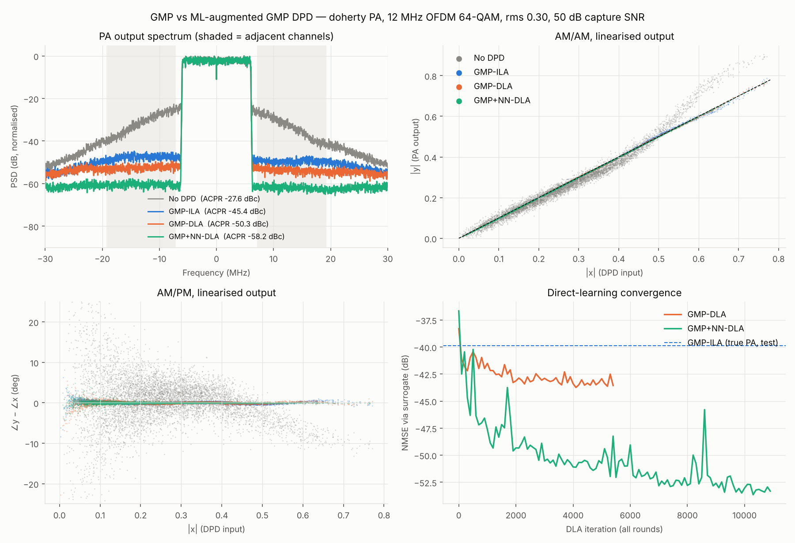

# fenrir-gmp-ml: GMP-DPD with a machine-learning variant

**Documentation:** [overview](docs/index.md) · [theory](docs/theory.md) · [tutorial](docs/tutorial.md) ·
[results](docs/results.md) · [API](docs/api.md) · [hardware notes](docs/hardware.md)

Pure NumPy/SciPy (no deep-learning framework; backprop is hand-written and gradient-checked),
so every operation maps directly onto something you could put in fixed-point RTL.

Four predistorters are compared on the same PA and signal:

| Name | Model | Identification |
|---|---|---|
| **GMP-ILA** | GMP, 99 coeffs (Ka=7/La=4 aligned, Kb=Kc=5/Lb=Lc=3/Mb=Mc=2 lag/lead) | Indirect learning, 4 iterations, ridge LS |
| **GMP-DLA** | same GMP | Direct learning: gradient descent through a learned NN PA surrogate |
| **GMP+NN-DLA** (the ML variant) | GMP + phase-equivariant NN residual gain | Direct learning, jointly trains GMP coeffs and NN |

GMP-DLA is included so you can separate how much gain comes from *direct learning*
(vs ILA's noise/post-inverse bias) and how much from the *NN residual*.

## The ML variant

```
z[n] = Σ_q c_q φ_q(x)[n]   +   x[n] · w( F(x)[n] )          w = MLP → (Re, Im) complex gain
         └── GMP ──────┘         └── NN residual ──┘
```

* **Phase-equivariant by construction.** Features `F` are |x[n-m]|, |x[n-m]|², Re/Im{x[n-m]·x*[n]}
  and low-passed |x|² (τ = 30, 150 samples, for long-term/thermal memory). All are invariant to
  a global phase rotation, and the NN output is applied as a complex *gain* on x[n], so the DPD
  commutes with carrier phase exactly — no need for the NN to learn rotations (unlike I/Q-input
  RVTDNN/ARVTDNN). Taps m ∈ −2…4 (2-sample look-ahead, matching the GMP leads).
* **Residual on GMP.** Initialised from the ILA solution with the NN output ≈ 0, so training
  starts from a working DPD and the NN only learns what the polynomial cannot (Doherty peaking
  knee, AM/PM bump, thermal droop).
* **Direct learning through a surrogate.** A differentiable PA model
  `S(z) = Σ h_l z[n-l] + z[n]·w_s(F(z))` (same equivariant structure, 2×64 tanh) is fitted on captures,
  then the DPD minimises `‖S(DPD(x)) − G·x‖²` with Adam. The GMP part is trained in a
  QR-orthonormalised basis (Φ = QR, c = R⁻¹d) so gradient descent is well conditioned.
* **Iterative refinement.** 3 rounds: capture PA with the current DPDs → fine-tune surrogate on
  all captures (so it is accurate exactly where the DPD drives it) → fine-tune DPDs.

## Test setup

* 12 MHz CP-OFDM, 64-QAM, 200/1024 subcarriers, fs = 61.44 MHz (5.1× oversampled), clip-and-filter
  CFR to 8.4 dB PAPR. Separate train (48 symbols) and test (40 symbols) waveforms.
* PA: Wiener-Hammerstein, `H1 → Doherty static NL → thermal droop → H2`. Doherty = class-AB carrier
  saturating at ~half voltage + class-C peaking amp turning on at |u| ≈ 0.45 with −25° relative
  phase → AM/AM knee/expansion and an AM/PM bump. Droop: gain × (1 − 0.1·LPF₈₀{|u|²}).
  A smooth `--pa rapp` model is also available (GMP alone does ~−50 dB on it — little for ML to add).
* Captures used for identification have 50 dB SNR receiver noise; metrics use the clean PA output
  on the *test* waveform through the *true* PA (not the surrogate).
* ACPR: measurement BW = 12 MHz, adjacent channels at ±13.2 MHz; worst side reported.

## Results (Doherty PA, rms drive 0.30)

| | NMSE (dB) | ACPR worst (dBc) | EVM (%) |
|---|---:|---:|---:|
| No DPD | −17.4 | −27.6 | 11.62 |
| GMP-ILA | −39.9 | −45.4 | 0.56 |
| GMP-DLA | −43.4 | −50.3 | 0.39 |
| **GMP+NN-DLA** | **−51.5** | **−58.2** | **0.14** |

Surrogate accuracy on the test waveform vs true PA: −46.5 dB (round 1) → −49.9 dB (round 3).
Direct learning alone buys ~3.5 dB NMSE / ~5 dB ACPR over ILA; the NN residual adds another ~8 dB.



Complexity per sample (rough real-op counts, see `complexity()` methods):

| | Coefficients | ~Real ops / sample | tanh / sample |
|---|---:|---:|---:|
| GMP (ILA or DLA) | 99 complex | ~600 | 0 |
| GMP+NN | 99 complex + 1,346 NN weights | ~1,900 | 48 |

## Files

```
dpd/signals.py     OFDM + CFR, NMSE / ACPR / EVM
dpd/pa.py          Rapp and Doherty Wiener-Hammerstein PA with thermal memory
dpd/gmp.py         GMP basis, ridge LS, ILA loop
dpd/nn.py          MLP, complex Adam, equivariant features, NN surrogate, GMP+NN DPD + DLA trainer
run_demo.py        end-to-end benchmark (python run_demo.py [--pa rapp] [--rms 0.3] [--snr 50] [--quick])
plot_results.py    figure from results/
tests/test_gradcheck.py   finite-difference check of all hand-written gradients
examples/tutorial.py      step-by-step guided run (see docs/tutorial.md)
examples/drive_sweep.py   no-DPD vs GMP-ILA over drive level, both PA models
docs/                     full documentation
results/           results.json, waveforms.npz, dpd_params.npz (GMP coeffs + NN weights/feature scaling)
```

Runtime: ~15 min on 2 CPU cores (`--quick` ≈ 4 min).

## Notes / next steps for hardware

* NN MLP is 28→24→24→2 tanh: ~1.3k MACs/sample. At 61.44 MS/s that is ~80 GMAC/s — fine for an
  RFSoC/FPGA DSP array; tanh as a small LUT/PWL. Quantise with QAT using the same DLA loop.
* The LPF features are 1-pole IIRs in hardware (the FIR kernels here are their truncated impulse responses).
* For a real bench, replace `pa(...)` with capture → time/phase/gain alignment; the surrogate absorbs
  the rest. Keep capture SNR high: the surrogate floor (~−45 dB here) bounds DLA.
