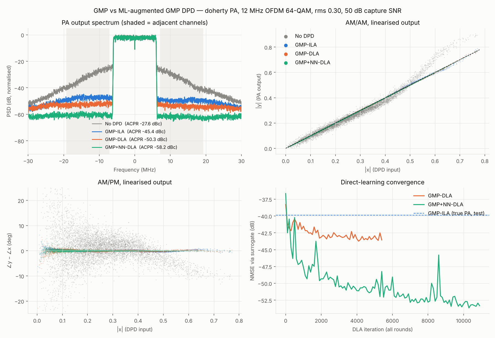

# Results

Results for the 20 MHz Wi-Fi signal are on a separate page: [20 MHz Wi-Fi](wifi20.md).

All numbers are simulated. The PA is the behavioural model in `dpd/pa.py`, not hardware.
Identification uses captures with 50 dB SNR receiver noise. Scoring uses the clean PA output on an
independent test waveform through the true PA model, never the surrogate.

## Setup

| Item | Value |
|---|---|
| Signal | CP-OFDM, 64-QAM, 200 of 1024 subcarriers, 60 kHz spacing, **12 MHz** occupied |
| Sample rate | 61.44 MHz (5.1× oversampled) |
| CFR | Kaiser channel filter + 5× clip-and-filter, **8.4 dB PAPR** |
| Waveforms | train 48 symbols (52,608 samples), test 40 symbols (43,840 samples), different seeds |
| PA | Doherty Wiener-Hammerstein + thermal droop (κ = 0.1, τ = 80 samples), unit small-signal gain |
| Drive | rms 0.30 (peaks ≈ 0.79 into the peaking region) |
| Capture SNR | 50 dB |
| GMP | 99 coefficients (Ka=7/La=4; Kb=Kc=5, Lb=Lc=3, Mb=Mc=2) |
| NN residual | 28 → 24 → 24 → 2, tanh, 1,346 parameters |
| Surrogate | FIR(6) + 24 → 64 → 64 → 2, tanh |
| Schedule | surrogate 8,000 it; DLA round 1: GMP 2,500 / NN 5,000 it; rounds 2–3: surrogate 4,000, GMP 1,500, NN 3,000 it |
| Command | `python run_demo.py` (seed 7), 870 s on 2 CPU cores. LPF features as 320-tap FIR truncations (`--lpf-len auto` selects this for `lte12`, so the command still reproduces these numbers) |

## Main result

| DPD | NMSE (dB) | ACPR lower / upper (dBc) | EVM (%) | Peak \|z\| |
|---|---:|---:|---:|---:|
| None | −17.4 | −27.6 / −29.4 | 11.62 | 0.78 |
| GMP-ILA | −39.9 | −45.4 / −47.4 | 0.56 | 0.65 |
| GMP-DLA | −43.4 | −50.3 / −51.6 | 0.39 | 0.65 |
| **GMP+NN-DLA** | **−51.5** | **−58.2 / −59.7** | **0.14** | **0.64** |

**Spectrum (top left).** The no-DPD spectrum shows strong, asymmetric regrowth; the asymmetry comes from memory
plus AM/PM. GMP-ILA lowers the shoulders by about 18 dB. GMP-DLA adds about 5 dB. The NN variant pushes the
regrowth floor to about −60 dB relative to the in-band level, and it is flat across the adjacent channel.

**AM/AM and AM/PM (top right, bottom left).** The raw PA expands above |x| ≈ 0.45 where the peaking
amplifier turns on. Its phase moves by up to about 10° with amplitude, and memory adds a wide spread around that curve. All three DPDs collapse this onto the
unit line. The scatter shows the remaining differences poorly at this scale; the spectrum and NMSE carry them.

**Convergence (bottom right).** This is the training-window NMSE through the surrogate, over all rounds. GMP-DLA
plateaus near −43 dB, which is its model-class limit. GMP+NN keeps improving at each round boundary as the
surrogate gets better. The spikes come from random-window minibatches and from the surrogate being re-fitted
at round boundaries (NN iterations 5,000 and 8,000).

### Where the gain comes from

| Step | ΔNMSE | ΔACPR | Cause |
|---|---:|---:|---|
| ILA → DLA (same GMP) | +3.5 dB | +4.9 dB | Optimising the actual pre-inverse; no noise in the regressor |
| GMP-DLA → GMP+NN-DLA | +8.1 dB | +7.9 dB | NN residual: peaking knee, AM/PM bump, long-term memory |

Both DPDs use the same peak drive (about 0.64 to 0.65), so the NN's gain is not bought with extra PA headroom.

## Round-by-round

| Round | Surrogate NMSE on test (dB) | GMP-DLA NMSE / ACPR | GMP+NN-DLA NMSE / ACPR / EVM |
|---|---:|---|---|
| 1 | −46.5 | −42.7 / −49.1 | −48.1 / −53.5 / 0.19 % |
| 2 | −48.7 | −43.2 / −50.1 | −50.2 / −56.7 / 0.17 % |
| 3 | −49.9 | −43.4 / −50.3 | −51.5 / −58.2 / 0.14 % |

The NN DPD tracks the surrogate closely: its final NMSE (−51.5 dB) is at the level of the surrogate's
own error (−49.9 dB). It can end slightly better because the surrogate's error is not fully aligned
with the DPD's error. The practical limit is the PA model, not the DPD. More capture rounds, longer surrogate training, or a larger surrogate would likely help further;
on a real bench, capture SNR and alignment set this floor.

## Shorter runs

Shorter training gives the same ordering with smaller margins:

| Run | GMP-ILA | GMP-DLA | GMP+NN-DLA |
|---|---|---|---|
| `run_demo.py --quick --rounds 2` (35 % iterations) | −39.9 / −45.4 | −42.3 / −48.6 | −46.4 / −51.9 |
| `examples/tutorial.py` (1 refinement) | −39.4 / −45.1 | −42.3 / −48.7 | −47.2 / −53.0 |

Values are NMSE dB / ACPR dBc.

## Drive-level sweep and PA model (GMP-ILA baseline)

From `python examples/drive_sweep.py` (seed 1, 40-symbol waveforms). It runs the baseline only, so it is fast.

| PA | rms | No DPD NMSE / ACPR | GMP-ILA NMSE / ACPR | GMP-ILA EVM |
|---|---:|---|---|---:|
| Rapp | 0.22 | −19.3 / −38.9 | −57.5 / −69.5 | 0.12 % |
| Rapp | 0.26 | −18.1 / −36.5 | −54.4 / −68.3 | 0.17 % |
| Rapp | 0.30 | −16.9 / −34.5 | −51.0 / −65.4 | 0.26 % |
| Rapp | 0.34 | −15.8 / −32.9 | −45.7 / −57.5 | 0.45 % |
| Doherty | 0.22 | −20.6 / −35.3 | −44.4 / −49.8 | 0.36 % |
| Doherty | 0.26 | −19.2 / −30.2 | −42.1 / −47.6 | 0.44 % |
| Doherty | 0.30 | −17.4 / −27.8 | −39.6 / −45.3 | 0.58 % |
| Doherty | 0.34 | −16.1 / −26.5 | −39.4 / −45.6 | 0.60 % |

On the smooth Rapp PA, the GMP alone is already near −50 dB at the benchmark drive, leaving little for an NN to add.
On the Doherty, the polynomial saturates around −40 to −44 dB at every drive level. That shortfall is
a model-class limit, and it is the regime where the ML variant earns its extra complexity.

## Complexity

| DPD | Parameters | ~Real ops / sample | tanh / sample |
|---|---|---:|---:|
| GMP | 99 complex | ~590 | 0 |
| GMP+NN | 99 complex + 1,346 real | ~1,920 | 48 |

These are rough counts. The GMP figure is basis generation plus a complex MAC per coefficient. The NN figure is
1,296 MACs, about 30 feature ops, and the output multiply. See [Hardware notes](hardware.md).

## Limitations and caveats

* **Simulated PA.** The Doherty model is behavioural. A real device has richer memory, bias and supply
  effects, and temperature dependence. The method is model-agnostic, but the absolute numbers are not predictions for any device.
* **Ideal alignment.** Captures are perfectly time- and phase-aligned with a known gain. On a bench,
  alignment error enters every method's floor.
* **Fixed operating point.** Each DPD is trained at one drive level and one signal type. Generalisation across
  power levels or bandwidths is not tested here. The ILA-initialised GMP part provides a reasonable fallback.
* **Same signal statistics in train and test.** The test waveform is independent but has the same format;
  generalisation to other modulation formats or channel configurations is not tested.
* **Latency.** The NN features use a 2-sample look-ahead, the same as the GMP leading terms.
* **Single seed.** Run-to-run variation from NN initialisation and minibatch sampling is not characterised.
