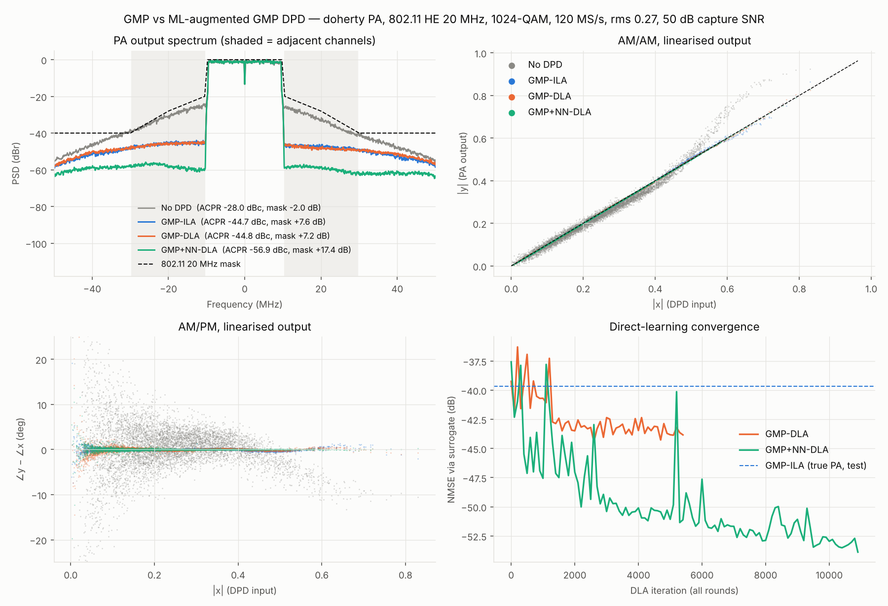

# 20 MHz Wi-Fi (IEEE 802.11)

The same DPD flow, retargeted from the 12 MHz LTE-like signal to a 20 MHz 802.11 channel.
The default is **802.11ax (HE) 20 MHz**: 242 tones (RU242), 1024-QAM, **no crest-factor reduction**,
with the DPD running at **120 MS/s**. Legacy (11a/g), HT (11n), VHT (11ac) and EHT (11be, 4096-QAM)
tone plans are selectable.

```bash
python run_demo.py --signal wifi20                    # HE20, 1024-QAM, 120 MS/s  (~17 min, 2 cores)
python run_demo.py --signal wifi20 --wifi-mode eht    # 4096-QAM, EVM requirement -38 dB
python run_demo.py --signal wifi20 --osr 5            # DPD at 100 MS/s instead of 120
python plot_results.py results_wifi20
```

## What changed relative to the 12 MHz setup

| Item | 12 MHz LTE-like | 20 MHz Wi-Fi (HE20) |
|---|---|---|
| Tones | 200 × 60 kHz, contiguous | ±2…±122 × 78.125 kHz (242), 3 DC nulls |
| Occupied BW (tone span) | 12.0 MHz | 19.14 MHz |
| Modulation | 64-QAM | 1024-QAM (all tones, pilots treated as data) |
| Symbol | 1024 + 72 CP @ 61.44 MS/s | 1536 + 96 (0.8 µs GI) @ 120 MS/s = 13.6 µs |
| DPD sample rate | 61.44 MS/s (5.1× BW) | **120 MS/s** (6× the 20 MHz channel, 6.3× the tone span) |
| CFR | clip-and-filter to 8.4 dB PAPR | **none**: test waveform PAPR ≈ 11 dB |
| TX channel filter | 401-tap Kaiser, cutoff 0.52·BW | 1033-tap Kaiser, cutoff BW/2 + 0.5 MHz |
| ACPR / ACLR | adjacent channels at ±13.2 MHz | adjacent 20 MHz channels at **±20 MHz**, 19.14 MHz measurement BW |
| Spectral mask | none | **802.11ax 20 MHz mask** (below) |
| EVM | one complex-gain fit | **per-subcarrier equalisation**, compared with the 802.11 requirement |
| Drive (rms) | 0.30 | **0.27** (see "Operating point") |
| NN low-pass features | 320-tap FIR truncation, τ = 30 / 150 samples | **exact one-pole IIR**, τ = 58.6 / 293 samples (same 0.49 / 2.44 µs) |
| PA thermal τ | 80 samples (1.30 µs) | 156 samples (1.30 µs) |
| DLA window / warm-up | 6,144 / 400 samples | 12,682 / 1,464 samples (warm-up = 5 τ of the slowest IIR) |
| Train / test | 48 / 40 symbols | 63 / 52 symbols (0.86 / 0.71 ms) |

Network sizes, GMP orders, learning rates, iteration counts and the 3-round schedule are
unchanged. The per-sample model complexity is therefore the same, but it runs at about 2× the rate.

### Why 120 MS/s

The DPD output must contain the inverse of the PA's intermodulation, which is wider than the signal.
About 5× the occupied bandwidth is the usual rule; 5 × 19.1 MHz ≈ 96 MS/s. The mask also has to be
observable out to ±30 MHz and beyond. 120 MS/s (osr = 6, a 1536-point FFT) gives ±60 MHz of Nyquist
band with margin. `--osr 5` (100 MS/s) is about 17% cheaper in hardware but has not been benchmarked here.

### Time constants are physical, not per-sample

Everything that represents a physical time is scaled by `fs / 61.44 MHz`: the PA's thermal droop, the NN
low-pass features (in both the DPD and the surrogate), and the DLA warm-up. The trained weights are
tied to the sample rate. The short linear-memory filters H1/H2 of the behavioural PA are defined per
sample, so at 120 MS/s they represent about half the physical memory span they had at 61.44 MS/s.

### Exact IIR features

The low-pass features are now exact one-pole IIRs, `s[n] = a·s[n−1] + (1−a)·|x[n]|²`, with the adjoint
computed by running the same filter backwards in time. This matches what hardware would implement, and it
removes the 320-deep delay line that the old FIR truncation needed (see [Hardware notes](hardware.md)).
Because an IIR state starts at zero in each training window, the DLA warm-up is sized to 5τ of the
slowest filter.

## Metrics

| Metric | Definition here |
|---|---|
| Spectral mask | 802.11ax 20 MHz: 0 dBr to ±9.75 MHz, −20 dBr at ±10.5 MHz, −28 dBr at ±20 MHz, −40 dBr at ±30 MHz and beyond, linear in dB between points. PSD in dBr relative to the in-band peak, Welch with about 50 kHz bins (Blackman-Harris ENBW ≈ 100 kHz, the mask RBW). **Margin** = worst-case limit minus PSD over \|f\| ≥ 9.75 MHz; > 0 means pass. The absolute −53 dBm/MHz floor is not applied. |
| ACLR | power in the adjacent 20 MHz channels (19.14 MHz measurement BW at ±20 MHz) relative to the main channel; worst side |
| EVM | per-subcarrier LS equalisation over all symbols (an ideal channel estimate, slightly optimistic versus a preamble-based estimate). No CFR is applied, so the EVM includes all transmitter distortion and compares directly with the requirement: −35 dB for HE MCS11 (1024-QAM) |
| NMSE | as before, against the fixed linear target |

## Operating point

Without CFR the HE20 waveform has about 11 dB PAPR on the 52-symbol test signal. The Doherty model's output
saturates at about 0.96. At the 12 MHz benchmark's drive (rms 0.30) the largest test peaks would need about 1.0
or more at the output, which is physically impossible, so part of the error is irreducible clipping.
At **rms 0.27** the highest peaks just reach saturation.

The fast drive sweep (GMP-ILA only, 24-symbol waveforms) shows the trend:

| rms | No DPD: NMSE / ACLR / mask / EVM | GMP-ILA: NMSE / ACLR / mask / EVM |
|---:|---|---|
| 0.20 | −21.9 / −37.0 / +6.0 / −32.2 dB | −45.5 / −51.0 / +13.6 / −50.8 dB |
| 0.24 | −20.5 / −31.3 / +0.9 / −25.9 dB | −39.3 / −44.4 / +7.2 / −45.1 dB |
| 0.27 | −19.1 / −28.5 / −1.9 / −23.1 dB | −40.6 / −46.0 / +7.6 / −46.1 dB |
| 0.30 | −17.7 / −26.8 / −3.5 / −21.5 dB | −39.6 / −45.3 / +6.2 / −44.9 dB |

Without DPD this PA fails the −35 dB EVM requirement at every drive level tested, and fails the
mask from rms ≈ 0.27.

## Results (HE20, 1024-QAM, rms 0.27, 50 dB capture SNR)

`python run_demo.py --signal wifi20` (seed 7), 1,032 s on 2 CPU cores. Scored on the 52-symbol test
waveform through the true PA.

| DPD | NMSE (dB) | ACLR worst (dBc) | EVM | Mask margin | Peak \|z\| |
|---|---:|---:|---:|---:|---:|
| None | −18.8 | −28.0 | 7.46 % (−22.5 dB) | **−2.0 dB (fail)** | 0.96 |
| GMP-ILA | −39.6 | −44.7 | 0.55 % (−45.1 dB) | +7.6 dB | 1.06 |
| GMP-DLA | −39.8 | −44.8 | 0.60 % (−44.5 dB) | +7.2 dB | 0.77 |
| **GMP+NN-DLA** | **−50.5** | **−56.9** | **0.13 % (−57.7 dB)** | **+17.4 dB** | 0.84 |

Against the HE MCS11 EVM requirement of −35 dB:

- **No DPD** fails by 12.5 dB.
- **GMP** (either training method) passes with about 10 dB of margin.
- **GMP+NN** passes with about 23 dB of margin.

It also passes the EHT 4096-QAM requirement (−38 dB) by about 20 dB. Note that in a real transmitter the
EVM budget is shared with phase noise, IQ imbalance and quantisation, so the PA's share is only part of the total.



**Spectrum.** Without DPD the regrowth breaks the mask around ±10.5 to 30 MHz. Both GMP variants leave a
shoulder at about −45 dBr, which is roughly 7 dB inside the mask at its tightest point. GMP+NN pushes the
out-of-band floor to about −57 to −63 dBr, flat across both adjacent channels.

### Round by round

| Round | Surrogate NMSE (test) | GMP-DLA NMSE / ACLR / mask | GMP+NN-DLA NMSE / ACLR / EVM / mask |
|---|---:|---|---|
| 1 | −46.0 dB | −40.0 / −45.2 / +6.6 | −47.2 / −52.5 / −56.3 dB / +12.7 |
| 2 | −47.7 dB | −40.1 / −45.2 / +7.2 | −49.4 / −55.4 / −57.4 dB / +15.7 |
| 3 | −49.0 dB | −39.8 / −44.8 / +7.2 | −50.5 / −56.9 / −57.7 dB / +17.4 |

### What is different from the 12 MHz result

- **Direct learning no longer helps the plain GMP.** GMP-DLA ends level with ILA (−39.8 vs −39.6 dB), while
  on the 12 MHz signal it gained 3.5 dB. Through the surrogate it reaches about −43.5 dB on training windows,
  but that does not carry over to the true PA. The GMP is limited by its model class at this
  drive, and the remaining gap is surrogate mismatch. This is one run, so treat that conclusion as tentative.
- **The NN correction does all the work.** It adds 10.7 dB NMSE, 12.1 dB ACLR and 10.2 dB mask margin over GMP-DLA,
  more than the 8 dB it added at 12 MHz. That is consistent with the higher PAPR driving the PA
  deeper into the Doherty peaking region, where a 7th-order polynomial fits poorly.
- **Peaks.** The ILA predistorter drives a peak of 1.06 into the PA. The two direct-learning DPDs stay below about 0.85. A likely reason is that the surrogate
  has seen little data near saturation, so pushing harder into it brings no apparent benefit in the loss; this has not been investigated further.

## Hardware implications

The per-sample cost is unchanged (99 GMP coefficients, the 28→24→24→2 MLP, about 1,920 real ops and 48 tanh per sample, see
[Hardware notes](hardware.md)), but the rate rises from 61.44 to 120 MS/s:

| | 61.44 MS/s (12 MHz) | 120 MS/s (Wi-Fi 20 MHz) |
|---|---:|---:|
| MLP throughput | 80 GMAC/s | 156 GMAC/s |
| Total real multiplies (direct GMP form) | 118 G/s | 231 G/s |
| Clock / cycles per sample (example) | 491.52 MHz / 8 | 480 MHz / 4 |
| Multipliers, direct GMP form | ≈ 240 | ≈ 480 |
| Multipliers, LUT-GMP form | ≈ 180 | ≈ 355 |

The figures are rough and come from op counts, not synthesis. Ways to bring this down, none benchmarked yet:

- `--osr 5`, which gives 100 MS/s;
- a smaller MLP;
- 8 to 10 bit MLP arithmetic after quantisation-aware training.

## Limitations specific to this Wi-Fi setup

- **Continuous data symbols only.** There is no preamble and no packet bursts with idle gaps. Real Wi-Fi is bursty, and
  the PA's thermal state changes at every packet start. The slow LPF features are the right mechanism for this,
  but burst transients are not exercised here.
- **Pilots carry QAM data, and EVM uses an ideal per-subcarrier channel estimate.** Pilot-based phase tracking is not modelled.
- **No CFR.** This makes the EVM comparison with the spec direct, but it limits drive to where the rare 11 dB peaks still fit under saturation.
  Mild CFR would allow more power at some EVM cost; that trade-off is not explored here.
- Only HE20 has been benchmarked. The other tone plans run through the same code but have not been evaluated.
- The PA is a behavioural Doherty model, and this is a single seed.
